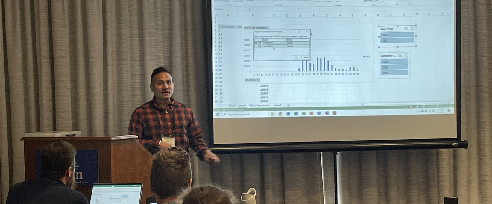

::: {.home-hero}

::: {.home-intro}

I am a spatial data scientist and public health professional working at the intersection of geographic information systems, mosquito control, remote sensing, and field operations.

I build geospatial tools and analytical workflows that connect surveillance, remote sensing, and field operations. My work helps organizations transform complex data to clear, defensible actions.

I currently lead technical development at Collier Mosquito Control District, where I work across GIS, spatial analytics, unmanned aircraft systems, and operational mosquito control.

:::

::: {.home-photo}

:::

:::

::: {.home-work}

## Selected work

::: {.home-work-grid}

::: {.work-feature .work-feature-kde}

01

### Mosquito Complaint Hotspot Analysis

A year-by-year view of where 28,889 resident mosquito complaints concentrated across Collier County from 2020 through 2026. A consistent 1,500-meter kernel density surface and fixed scale make patterns comparable while keeping complaint intensity distinct from mosquito abundance.

Kernel density estimation · R · sf · Leaflet

[Explore the interactive analysis](https://atom-geo.github.io/sr_kde_collier/){.work-feature-link}
:::

::: {.work-feature .work-feature-asap}

02

### Aerial Swath Analysis Platform (ASAP)

A guided web application for processing and visualizing granular aerial-application calibration data. ASAP evaluates application rate, granular density, swath uniformity, and overlap so operational teams can identify clear, reproducible calibration parameters.

Granular applications · Swath modeling · Calibration

::: {.work-feature-links}
[Launch the live application](https://atom-sds-asap.share.connect.posit.cloud/){.work-feature-link}

[View the source repository](https://github.com/atom-rosales/ASAP){.work-feature-link}

[Read the published article](https://jamca.kglmeridian.com/view/journals/moco/42/3/article-p237.xml){.work-feature-link}
:::

:::

:::

:::

::: {.home-sections}

::: {.home-section}
## About

This is my professional portfolio. It brings together selected work in spatial data science, GIS, UAS, remote sensing, and public health operations.

For more about my background and how I came to this work, visit the [About page](about.qmd) or [download my CV](assets/about/Atom_Rosales_Resume.pdf).
:::

::: {.home-section}
## Connect

- Email me at [atommrosales@gmail.com](mailto:atommrosales@gmail.com).
- Track my scholarly work on [ORCID](https://orcid.org/0000-0001-8702-1194).
- Find my publications on [Google Scholar](https://scholar.google.com/citations?user=OHq3Kv4AAAAJ&hl=en).
- See my code projects on [GitHub](https://github.com/atom-geo).
:::

:::
