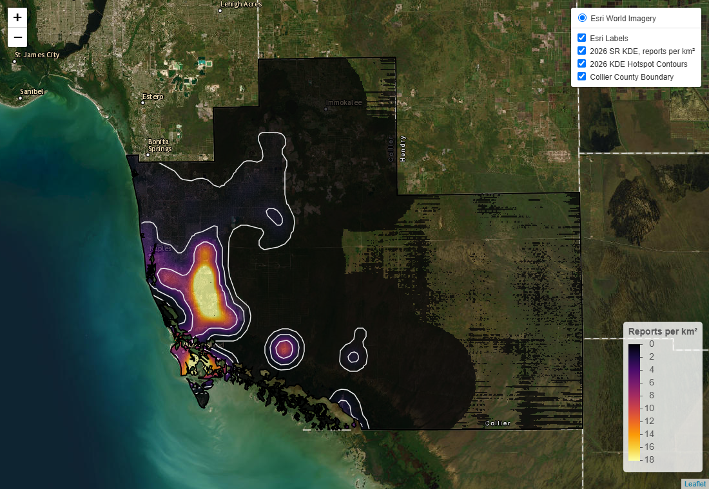
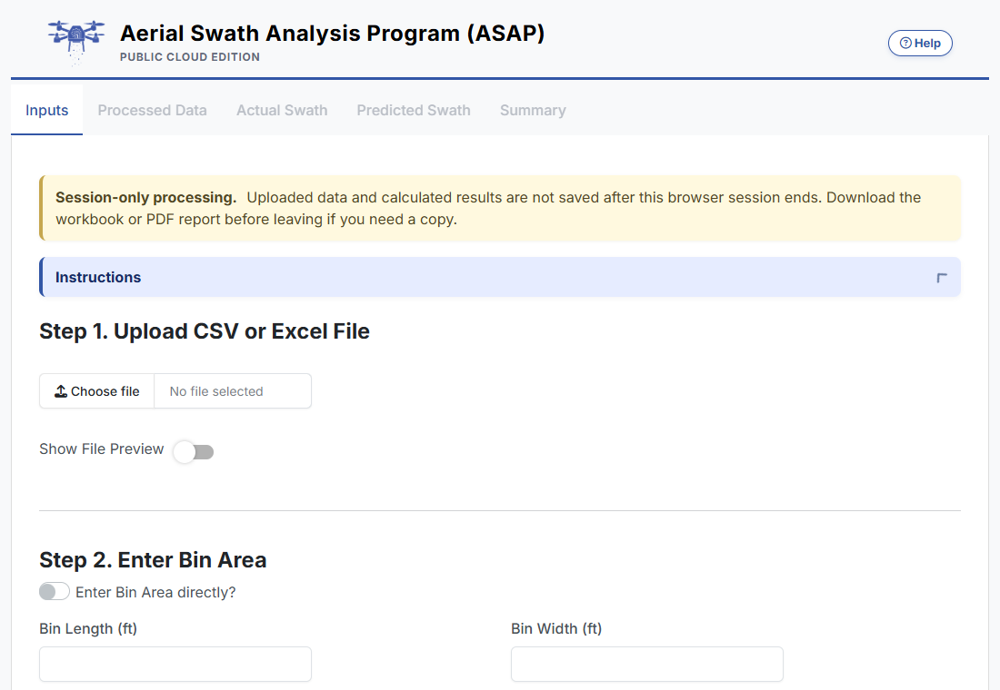
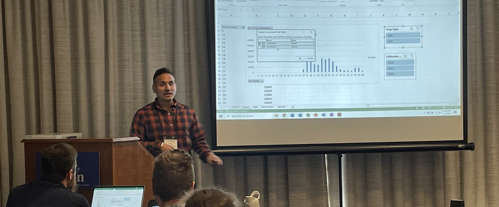

```{=html}
<main id="main">
    <section id="top" class="hero" aria-labelledby="hero-title">
      <div id="hero-map" class="hero-map" aria-hidden="true"></div>
      <div class="container hero-inner">
        <div class="hero-copy">
          <p class="eyebrow"><span class="small-line" aria-hidden="true"></span> Spatial data science &amp; public health</p>
          <h1 id="hero-title">Atom Rosales<span class="heading-period">.</span>
</h1>
          <p class="hero-role">Field experience.<br>Spatial intelligence.</p>
          <p class="hero-summary">I turn surveillance, environmental, and operational data into tools that support better public health decisions.</p>
          <div class="hero-actions">
            <a class="button button-primary" href="#work">Explore my work <i data-lucide="arrow-down" aria-hidden="true"></i></a>
            <a class="text-link" href="assets/about/Atom_Rosales_Resume.pdf" target="_blank" rel="noopener">View CV <i data-lucide="arrow-up-right" aria-hidden="true"></i></a>
          </div>
        </div>
        <div class="map-caption">
          <span class="map-caption-label"><span class="map-key" aria-hidden="true"></span> Collier County, Florida</span>
          <span>Resident complaint contours</span>
        </div>
        <div class="map-controls" aria-label="Complaint contour year">
          <div class="map-year-stat" aria-live="polite">
<strong id="map-count">3,715</strong><span>reports in <span id="map-year-label">2026</span></span>
</div>
          <div class="year-picker" role="group" aria-label="Map year">
            <button type="button" data-year="2020" aria-pressed="false">2020</button>
            <button type="button" data-year="2023" aria-pressed="false">2023</button>
            <button type="button" data-year="2026" aria-pressed="true">2026</button>
          </div>
        </div>
        <span class="map-coordinate" aria-hidden="true">26.1&#176; N &#160; 81.5&#176; W</span>
      </div>
    </section>

    <section class="credentials" aria-label="Professional background">
      <div class="container credentials-inner">
        <div>
<i data-lucide="briefcase-business" aria-hidden="true"></i><p><strong>Director of Technical Development</strong><span>Collier Mosquito Control District</span></p>
</div>
        <div>
<i data-lucide="graduation-cap" aria-hidden="true"></i><p><strong>M.S. Spatial Data Science</strong><span>The Pennsylvania State University</span></p>
</div>
        <a href="https://orcid.org/0000-0001-8702-1194" target="_blank" rel="noopener"><i data-lucide="book-open" aria-hidden="true"></i><p><strong>Research &amp; applied practice</strong><span>View my scholarly record <i data-lucide="arrow-up-right" aria-hidden="true"></i></span></p></a>
      </div>
    </section>

    <section id="work" class="work-section section-space" aria-labelledby="work-title">
      <div class="container">
        <div class="section-heading">
<div>
<p class="eyebrow">Analysis into action</p>
<h2 id="work-title">Selected work</h2>
</div>
<span class="section-index" aria-hidden="true">01 / 03</span>
</div>

        <article class="project">
          <div class="project-copy">
            <p class="project-category"><span>01</span> Spatial analysis &amp; visualization</p>
            <h3>Mosquito Complaint<br class="desktop-break"> Hotspot Analysis</h3>
            <p>Seven years of resident reports. A clearer picture of where complaints concentrate, and how those patterns change.</p>
            <dl class="project-facts">
<div>
<dt>Scope</dt>
<dd>28,889 reports &#183; 2020&#8211;2026</dd>
</div>
<div>
<dt>Methods</dt>
<dd>Kernel density estimation, R, sf, Leaflet</dd>
</div>
</dl>
            <a class="project-link" href="https://atom-geo.github.io/sr_kde_collier/" target="_blank" rel="noopener">Explore the interactive map <i data-lucide="arrow-up-right" aria-hidden="true"></i></a>
          </div>
          <figure class="project-figure">
            <a class="project-image" href="https://atom-geo.github.io/sr_kde_collier/" target="_blank" rel="noopener" aria-label="Open Mosquito Complaint Hotspot Analysis"></a>
            <figcaption><span>Collier County &#183; 2026 complaint-intensity surface</span><span>KDE &#8800; mosquito abundance</span></figcaption>
          </figure>
        </article>

        <article class="project project-reverse">
          <div class="project-copy">
            <p class="project-category"><span>02</span> Software &amp; operational analytics</p>
            <h3>Aerial Swath<br class="desktop-break"> Analysis Platform</h3>
            <p>From field measurements to defensible calibration. A guided application for evaluating granular deposition, swath uniformity, and application overlap.</p>
            <dl class="project-facts">
<div>
<dt>Focus</dt>
<dd>Granular aerial-application calibration</dd>
</div>
<div>
<dt>Outputs</dt>
<dd>Application rates, swath models, reports</dd>
</div>
</dl>
            <a class="project-link" href="https://atom-sds-asap.share.connect.posit.cloud/" target="_blank" rel="noopener">Launch ASAP <i data-lucide="arrow-up-right" aria-hidden="true"></i></a>
            <div class="secondary-links">
<a href="https://github.com/atom-rosales/ASAP" target="_blank" rel="noopener"><i data-lucide="github" aria-hidden="true"></i> Source code</a><a href="https://doi.org/10.2987/26-7306" target="_blank" rel="noopener">Published article <i data-lucide="arrow-up-right" aria-hidden="true"></i></a>
</div>
          </div>
          <figure class="project-figure">
            <a class="project-image" href="https://atom-sds-asap.share.connect.posit.cloud/" target="_blank" rel="noopener" aria-label="Open the Aerial Swath Analysis Platform"></a>
            <figcaption><span>ASAP &#183; live application interface</span><span>Peer-reviewed software</span></figcaption>
          </figure>
        </article>
      </div>
    </section>

    <section id="about" class="about-section section-space" aria-labelledby="about-title">
      <div class="container">
        <div class="section-heading">
<div>
<p class="eyebrow">A little background</p>
<h2 id="about-title">About me</h2>
</div>
<span class="section-index" aria-hidden="true">02 / 03</span>
</div>
        <div class="about-grid">
          <figure class="about-photo"><figcaption>Technical instruction &#183; DODD Short Courses</figcaption></figure>
          <div class="about-copy">
            <p class="about-lead">I entered mosquito control as a seasonal field technician in Texas. Setting traps, identifying mosquitoes, maintaining equipment, and coordinating field activities gave me an appreciation for how much public health decisions depend on the quality and context of the underlying data.</p>
            <p>My interest in GIS grew from wanting to solve practical problems that were difficult to understand from tables alone. One of my earliest GIS projects brought together a county storm sewer dataset and the locations of <em>Culex quinquefasciatus</em> mosquito pools that had tested positive for West Nile virus. By examining where positive-pool hotspots aligned with the storm sewer network, I used the existing infrastructure data to identify potential underground breeding sites and help plan a more focused surveillance and response strategy.</p>
            <p>That project showed me how geographic information could connect surveillance results to features in the environment and turn an observed pattern into a practical course of action. It led me further into GIS, programming, data visualization, and spatial analysis. Over time, my work expanded from organizing individual surveillance routes to developing organization-wide data systems, operational dashboards, aerial application analyses, and drone-based remote-sensing workflows.</p>
            <p>I later completed a graduate certificate in geographic information systems and a master's degree in spatial data science at Penn State. My education strengthened the analytical foundation behind work that has always remained grounded in field operations and applied public health.</p>
            <div class="about-links">
<a class="text-link" href="about.html">More about my background <i data-lucide="arrow-up-right" aria-hidden="true"></i></a><a class="text-link" href="assets/about/Atom_Rosales_Resume.pdf" target="_blank" rel="noopener">Full CV <i data-lucide="file-text" aria-hidden="true"></i></a>
</div>
          </div>
        </div>
      </div>
    </section>

    <section id="contact" class="contact-section section-space" aria-labelledby="contact-title">
      <div class="container">
        <div class="section-heading">
<div>
<p class="eyebrow">Research, ideas &amp; collaboration</p>
<h2 id="contact-title">Reach out to me!</h2>
</div>
<span class="section-index" aria-hidden="true">03 / 03</span>
</div>
        <div class="contact-content">
<a class="contact-email" href="mailto:arosales@cmcd.org">arosales@cmcd.org <i data-lucide="arrow-up-right" aria-hidden="true"></i></a><p>Spatial data science, remote sensing, and practical<br class="desktop-break"> tools for public health operations.</p>
</div>
        <div class="social-links" aria-label="Professional profiles">
          <a href="https://github.com/atom-geo" target="_blank" rel="noopener"><i data-lucide="github" aria-hidden="true"></i> GitHub <i data-lucide="arrow-up-right" aria-hidden="true"></i></a>
          <a href="https://orcid.org/0000-0001-8702-1194" target="_blank" rel="noopener"><i data-lucide="fingerprint" aria-hidden="true"></i> ORCID <i data-lucide="arrow-up-right" aria-hidden="true"></i></a>
          <a href="https://scholar.google.com/citations?user=OHq3Kv4AAAAJ&amp;hl=en" target="_blank" rel="noopener"><i data-lucide="graduation-cap" aria-hidden="true"></i> Google Scholar <i data-lucide="arrow-up-right" aria-hidden="true"></i></a>
          <a href="https://www.linkedin.com/in/atom-rosales-659754380/" target="_blank" rel="noopener"><i data-lucide="linkedin" aria-hidden="true"></i> LinkedIn <i data-lucide="arrow-up-right" aria-hidden="true"></i></a>
        </div>
      </div>
    </section>
  </main>
```
